<picture><source media="(prefers-color-scheme: dark)" srcset="assets/hero-dark.svg"></picture>

<picture><source media="(prefers-color-scheme: dark)" srcset="assets/social-l-dark.svg"></picture><a href="https://discord.com/teto_verse"><picture><source media="(prefers-color-scheme: dark)" srcset="assets/social-1-dark.svg"></picture></a><a href="https://tiktok.com/@snox.ies"><picture><source media="(prefers-color-scheme: dark)" srcset="assets/social-2-dark.svg"></picture></a><a href="https://orcid.org/0009-0009-3681-1220"><picture><source media="(prefers-color-scheme: dark)" srcset="assets/social-3-dark.svg"></picture></a><a href="https://zenodo.org/search?q=metadata.creators.person_or_org.name%3A%22Hamza%20Mert%20Da%C5%9Fdemir%22&amp;l=list&amp;p=1&amp;s=10&amp;sort=bestmatch"><picture><source media="(prefers-color-scheme: dark)" srcset="assets/social-4-dark.svg"></picture></a><picture><source media="(prefers-color-scheme: dark)" srcset="assets/social-r-dark.svg"></picture>

<picture><source media="(prefers-color-scheme: dark)" srcset="assets/about-dark.svg"></picture>

<picture><source media="(prefers-color-scheme: dark)" srcset="assets/wave-dark.svg"></picture>

<picture><source media="(prefers-color-scheme: dark)" srcset="assets/stack-dark.svg"></picture>

<a href="https://github.com/tetoverse/hyper-lll"><picture><source media="(prefers-color-scheme: dark)" srcset="assets/project-hyper-lll-dark.svg"></picture></a>&nbsp;<a href="https://github.com/tetoverse/Raser"><picture><source media="(prefers-color-scheme: dark)" srcset="assets/project-raser-dark.svg"></picture></a>

<a href="https://github.com/tetoverse/hang-trace"><picture><source media="(prefers-color-scheme: dark)" srcset="assets/project-hang-trace-dark.svg"></picture></a>&nbsp;<a href="https://github.com/tetoverse/register-the-dev.xyz"><picture><source media="(prefers-color-scheme: dark)" srcset="assets/project-register-the-dev-xyz-dark.svg"></picture></a>

<picture><source media="(prefers-color-scheme: dark)" srcset="assets/stats-dark.svg"></picture>

<picture><source media="(prefers-color-scheme: dark)" srcset="assets/streak-dark.svg"></picture>

<a href="https://metawka.github.io/expressive-profile/?from=tetoverse"><picture><source media="(prefers-color-scheme: dark)" srcset="assets/credit-dark.svg"></picture></a>

